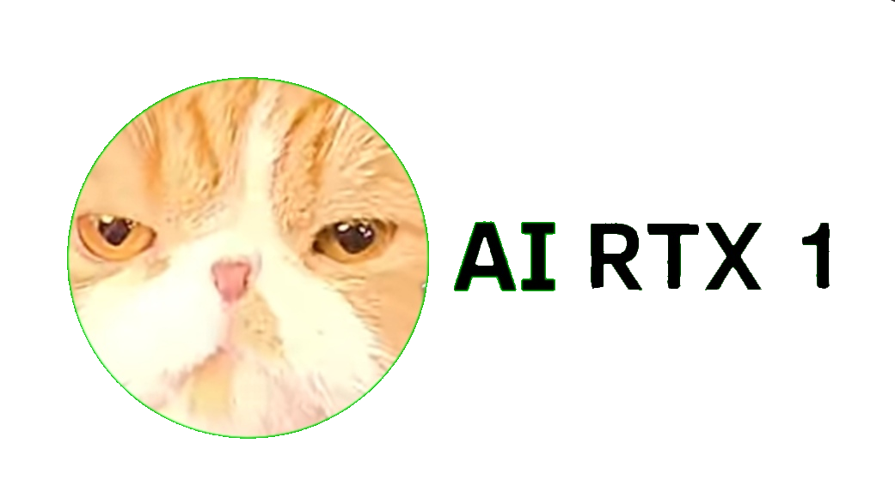

  

  
  
  

  **Один интерфейс. Множество AI-моделей. Безграничные возможности.**

🌐 Website: https://airtxone.netlify.app/
🤖 Telegram Bot: "@AI_RTX_One_bot" (https://t.me/AI_RTX_One_bot)

---

✨ Что такое AIRTX 1?

AIRTX 1 — это AI-платформа, созданная для удобной работы с искусственным интеллектом.

Общайся с AI, выбирай модели и исследуй возможности современных нейросетей в одном месте.

🔥 Возможности

- 🧠 Выбор AI-моделей.
- 🌐 Выбор AI-провайдера.
- 💬 Общение с искусственным интеллектом.
- 🖼️ Работа с графическими моделями.
- 🎬 Возможности генерации видео.
- ⚡ Удобный и современный интерфейс.
- 📱 Доступ через браузер.
- 🤖 Интеграция с Telegram-ботом.

Доступность отдельных функций зависит от подключённых моделей и провайдеров.

🖥️ Платформа

Компонент| Технология
Веб-сайт| Netlify
Telegram| Telegram Bot API
Backend бота| Python
AI API| Подключаемые провайдеры

🚀 Запуск сайта

Открой:

https://airtxone.netlify.app/

Начни пользоваться AIRTX 1 прямо в браузере.

🤖 Telegram

Наш Telegram-бот:

"@AI_RTX_One_bot" (https://t.me/AI_RTX_One_bot)

Запусти бота командой "/start".

🛠️ Установка Telegram-бота

Установи зависимости:

pip install -U python-telegram-bot httpx

Запусти:

python main.py

Перед запуском настрой Telegram Bot Token и необходимые API-ключи.

🔐 Безопасность

- Не публикуй API-ключи.
- Не добавляй секретные токены в открытый GitHub-репозиторий.
- Храни секреты в переменных окружения или защищённом серверном хранилище.

🎯 Наша цель

Создать удобную AI-платформу, объединяющую различные модели и инструменты искусственного интеллекта.

AIRTX 1 — The Future of AI Starts Here.

---

  🚀 **AIRTX 1**Powered by imagination. Built for the future.

